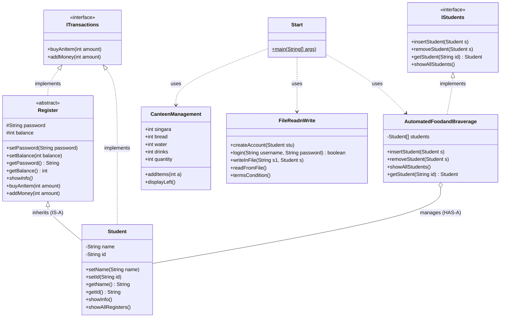

# Cafeteria-Management-System-by-java
# 🍽️ Cafeteria Management System

A robust, console-based **Cafeteria Management System** (EWU Automated Food & Beverage Service) developed in **Java**. Built as an Object-Oriented Programming (OOP) course project, this system streamlines university canteen operations—handling student account registrations, meal purchases, stock/inventory management, automated credit requests, and transaction logging.

---

## 📌 Table of Contents
- [Key Features](#-key-features)
- [System Architecture & OOP Concepts](#-system-architecture--oop-concepts)
- [Project Structure](#-project-structure)
- [Food & Beverage Menu](#-food--beverage-menu)
- [Prerequisites](#-prerequisites)
- [Getting Started & How to Run](#-getting-started--how-to-run)
  - [Command Line (Terminal)](#1-command-line-terminal)
  - [IntelliJ IDEA / Eclipse](#2-intellij-idea--eclipse)
- [Application Flow & Menu Navigation](#-application-flow--menu-navigation)
- [Data Storage & File I/O](#-data-storage--file-io)
- [Future Improvements](#-future-improvements)

---

## ✨ Key Features

### 👤 Student Account & Authentication
- **Registration**: Allows new students to create an account with a Name, Student ID, and Password.
- **Initial Semester Credit**: Automatically credits a starting balance of **2,500 TK** upon registration.
- **Authentication**: Validates credentials against stored records before granting access to ordering services.
- **Cancellation**: Supports registration cancellation with refund/semester rollover adjustment notifications.

### 🍱 Automated Ordering & Billing
- **Interactive Menu**: Students can order from Breakfast, Lunch, and Beverage categories.
- **Quantity Selection**: Specify item quantities with automatic total bill computation.
- **Instant Balance Deduction**: Calculates costs in real-time and deducts the amount from the student's prepaid account.
- **Transaction Audit Logging**: Automatically records each transaction into a persistent history file (`History.txt`).

### 💳 Financial & Credit Assistance
- **Balance Check**: Check real-time balance at any time.
- **Emergency Credit Grant**: If a student's balance falls below **100 TK**, they can request an instant emergency credit of **500 TK**.

### 📦 Cafeteria Inventory & Stock Management
- **Stock Tracking**: Monitors quantities for items such as Singara, Cream Bread, Mineral Water, and Soft Drinks.
- **Restocking**: Administrative utility to bulk-add inventory quantities.
- **Stock Depletion**: Reduces stock levels in sync with student purchases.

### 📜 Terms & Policy Viewer
- Integrated reader displaying cafeteria service rules and regulations directly from `Terms & Conditions.txt`.

---

## 🏛️ System Architecture & OOP Concepts

The project demonstrates fundamental Object-Oriented Programming principles:



### OOP Principles Applied
- **Inheritance**: `Student` inherits common account properties (`password`, `balance`, transaction methods) from the abstract `Register` class.
- **Abstraction**: Interfaces `IStudents` and `ITransactions` define contracts without exposing underlying implementation logic. `Register` serves as an abstract template.
- **Encapsulation**: Private attributes with public getters and setters ensure data integrity and controlled access.
- **Polymorphism**: Interface implementation in `AutomatedFoodandBraverage` (`IStudents`) and `Student` (`ITransactions`).
- **Robust Exception Handling**: Utilizes `try-catch` blocks to catch `InputMismatchException` for user input validation, as well as `IOException` / `FileNotFoundException` during disk operations.

---

## 📂 Project Structure

```
Cafeteria-Management-System-by-java/
├── src/
│   ├── Start.java                     # Main entry point and CLI menu router
│   ├── Student.java                   # Concrete Student entity
│   ├── Register.java                  # Abstract base class for account & balance
│   ├── IStudents.java                 # Interface defining student management operations
│   ├── ITransactions.java             # Interface for transaction and credit rules
│   ├── AutomatedFoodandBraverage.java # Service provider implementation (manages students)
│   ├── CanteenManagement.java         # Inventory tracking and stock replenishment
│   └── FileReadnWrite.java            # File handling (Auth, History, Terms)
├── History.txt                        # Audit trail of purchases and transactions
├── StudentInformation.txt             # Persistent store for student credentials
├── Terms & Conditions.txt             # Cafeteria policies and semester guidelines
├── ReportCSEoop110.docx               # Academic project report documentation
├── Cafeteria management.iml           # IntelliJ IDEA module descriptor
└── README.md                          # Project documentation
```

---

## 🍲 Food & Beverage Menu

| Category | Item Name | Price (TK) |
| :--- | :--- | :--- |
| **Breakfast** | Shingara | 5 TK |
| **Breakfast** | Cream Bread | 10 TK |
| **Lunch** | Plain Rice with Chicken Curry | 60 TK |
| **Lunch** | Plain Rice with Fish Curry | 60 TK |
| **Lunch** | Chicken Biriani | 70 TK |
| **Lunch** | Egg Fried Rice with Fried Chicken | 80 TK |
| **Beverage** | Mineral Water | 15 TK |
| **Beverage** | Coca-Cola | 20 TK |

---

## ⚙️ Prerequisites

- **Java Development Kit (JDK)**: Version 8 or higher (tested with JDK 8, 11, 17, 21, and 23).
- **Git** (optional, for cloning the repository).
- **IDE** (optional): IntelliJ IDEA, Eclipse, NetBeans, or VS Code.

---

## 🚀 Getting Started & How to Run

### 1. Command Line (Terminal)

1. **Clone or navigate** to the project directory:
   ```bash
   cd /path/to/Cafeteria-Management-System-by-java
   ```

2. **Compile** all Java source files into an output folder (e.g., `bin`):
   ```bash
   javac -d bin src/*.java
   ```

3. **Run** the main class:
   ```bash
   java -cp bin Start
   ```

> **Note on File Paths**: `FileReadnWrite.java` references `StudentInformation.txt`. If you run from another working directory or wish to use a relative path, ensure `StudentInformation.txt`, `History.txt`, and `Terms & Conditions.txt` are accessible in the execution directory.

---

### 2. IntelliJ IDEA / Eclipse

1. Open **IntelliJ IDEA** or your preferred IDE.
2. Select **Open** and choose the `Cafeteria-Management-System-by-java` folder.
3. Verify that the `src` folder is marked as **Sources Root** (`Right-click src -> Mark Directory as -> Sources Root`).
4. Set the Project SDK (Java 8 or higher).
5. Open `src/Start.java` and click **Run 'Start.main()'**.

---

## 🖥️ Application Flow & Menu Navigation

```text
=====================================================
 Welcome to EWU Automated Food & Beverage Service!
=====================================================
1. Read Terms And Condition.
2. Student Registration Or Login.
   ├── 1. Register New Student (Sets 2500 TK balance)
   ├── 2. Login Student
   ├── 3. Cancel Registration
   └── 4. Back
3. EWU Automated Food & Beverage Service (Requires Login):
   ├── 1. Breakfast Items (Shingara, Cream Bread)
   ├── 2. Lunch Items (Rice, Curry, Biriani, Fried Rice)
   ├── 3. Beverage Items (Water, Coca-Cola)
   ├── 4. Balance Information (Check Balance / Request 500 TK Credit)
   ├── 5. View Transaction History
   └── 6. Back
4. Items Management Service (Inventory):
   ├── 1. Add Items (Restock)
   ├── 2. Show Available Items (Stock levels)
   └── 3. Back
5. Show All Registered Students
6. EXIT
```

---

## 💾 Data Storage & File I/O

- **`StudentInformation.txt`**: Saves student registration details in comma-separated format (`Name,Password,ID`).
- **`History.txt`**: Logs timestamps/details of transactions, deductions, and items purchased.
- **`Terms & Conditions.txt`**: Contains university cafeteria policies read dynamically by the system.

---

## 🔮 Future Improvements

- [ ] Transition from text-file persistence to a relational database (e.g., SQLite / MySQL via JDBC).
- [ ] Migrate from a console CLI interface to a modern GUI (JavaFX / Swing) or a Spring Boot Web API.
- [ ] Add role-based authentication separating Student actions from Admin/Staff inventory control.
- [ ] Implement password hashing (e.g., BCrypt) for secure credential storage.

---

## 📄 License & Credits
Developed as an academic course project for **CSE OOP 110** at **East West University (EWU)**. Distributed for educational and reference purposes.
